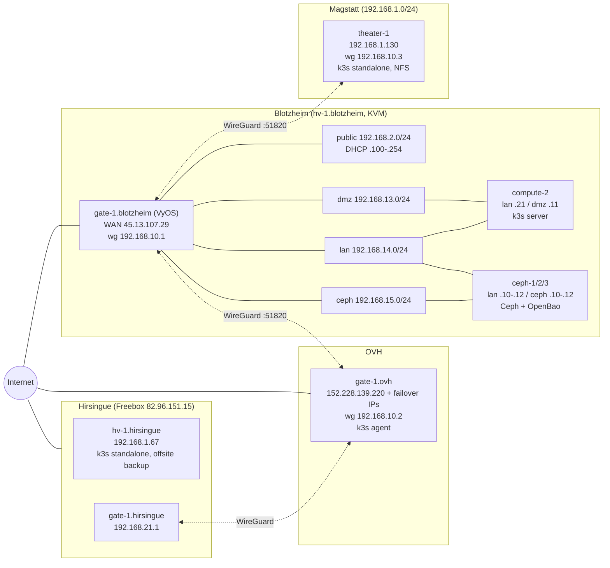

# mout.ch/ansible

Ansible configuration for all mout.ch infrastructure. Description to be completed.

Runbooks: [OpenBao](docs/openbao/README.md) ([upgrade](docs/openbao/upgrade.md))

# Network

Generated from the inventory, `host_vars` (netplan, WireGuard, VyOS) and checks
on the hosts in October 2026. `host_vars` stay the source of truth.

## Subnets

| CIDR | Name | Where | Hosts |
|---|---|---|---|
| `192.168.10.0/24` | WireGuard interco | `wg01` on gate-1.blotzheim, port 51820 | gate-1.blotzheim `.1`, gate-1.ovh `.2`, theater-1.magstatt `.3` |
| `192.168.2.0/24` | public | gate-1.blotzheim `eth1` (passthrough NIC) | gate `.1`, DHCP `.100`-`.254`, NAT to WAN |
| `192.168.13.0/24` | dmz | KVM bridge `virbr1` on hv-1.blotzheim | gate `.1`, compute-2 `.11` |
| `192.168.14.0/24` | lan | KVM bridge `virbr2` | gate `.1`, ceph-1/2/3 `.10`-`.12`, compute-2 `.21` |
| `192.168.15.0/24` | ceph (cluster network) | KVM bridge `virbr3` | gate `.1`, ceph-1/2/3 `.10`-`.12` |
| `192.168.11.0/24` | hypervisor | hv-1.blotzheim `eno1` | hv-1 `.30`, gateway `.1` |
| `192.168.1.0/24` | Magstatt home LAN | box `.1` | theater-1 `.130`, NFS clients `.132`, `.140` |
| `192.168.1.0/24` | Hirsingue home LAN | Freebox `.1` | hv-1.hirsingue `.67` |
| `192.168.21.0/24` | Hirsingue behind gate-1.hirsingue | gate-1.hirsingue `eth0` | gate `.1` |

## Public entry points

| Address | Host | Ports |
|---|---|---|
| `45.13.107.29` (`blotzheim.infra.mout.ch`, `vault.infra.mout.ch`) | gate-1.blotzheim WAN | 22, 51820/udp (WireGuard); 80, 443, 6443 forwarded to k3s on compute-2 `192.168.13.11`; 25565-25567 to NodePorts 30573-30575 |
| `152.228.139.220` + failover IPs | gate-1.ovh | VPS, k3s agent of the blotzheim cluster |
| `82.96.151.15` (`hirsingue.infra.mout.ch`) | Freebox, Hirsingue | 2222 forwarded to SSH on hv-1.hirsingue |

## k3s clusters

| Cluster | Nodes | Notes |
|---|---|---|
| blotzheim | compute-2 (server), gate-1.ovh (agent) | Cilium, ArgoCD, RBD storage on Ceph, API `192.168.14.21:6443` |
| theater-1 | theater-1.magstatt | standalone, reaches `192.168.14.0/24` through WireGuard |
| hv-1.hirsingue | hv-1.hirsingue | standalone, offsite backup target (RAID1 on `/var/lib/volumes/backup`) |

## Known inconsistencies

- gate-1.hirsingue and theater-1.magstatt both use WireGuard IP `192.168.10.3`.
- gate-1.hirsingue uses gate-1.ovh as WireGuard server, but gate-1.ovh is itself a client of gate-1.blotzheim. gate-1.hirsingue was unreachable in October 2026.
- hv-1.hirsingue sits on the Freebox LAN, not behind gate-1.hirsingue.

## Cilium

Installed by k3s itself from [files/k3s/cilium.yaml.j2](files/k3s/cilium.yaml.j2)
(a `HelmChart` with `bootstrap: true`, so it works on a fresh cluster before
any CNI exists). Version and values per cluster: `cilium_version` and
`cilium_values` in `host_vars`. Don't `helm upgrade` it by hand, bump the
version there instead.
